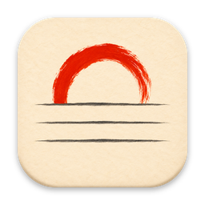
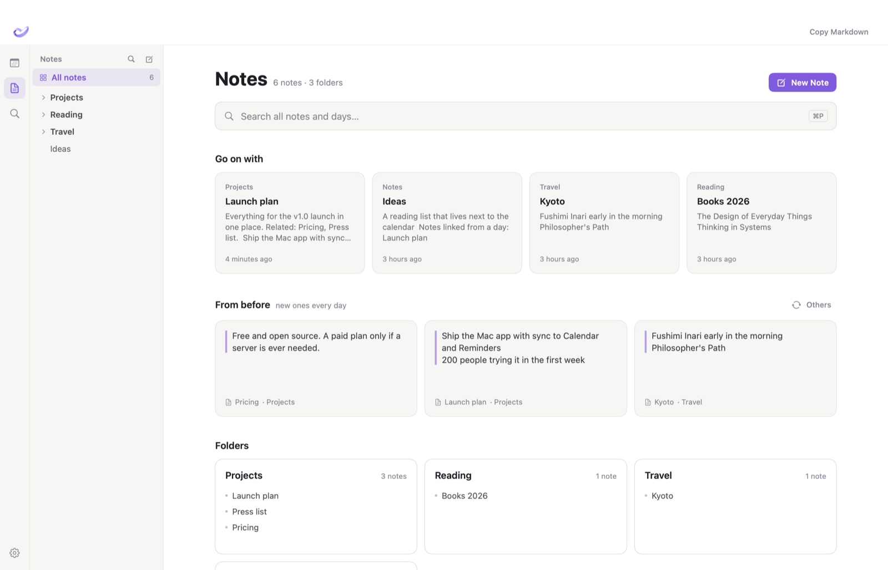
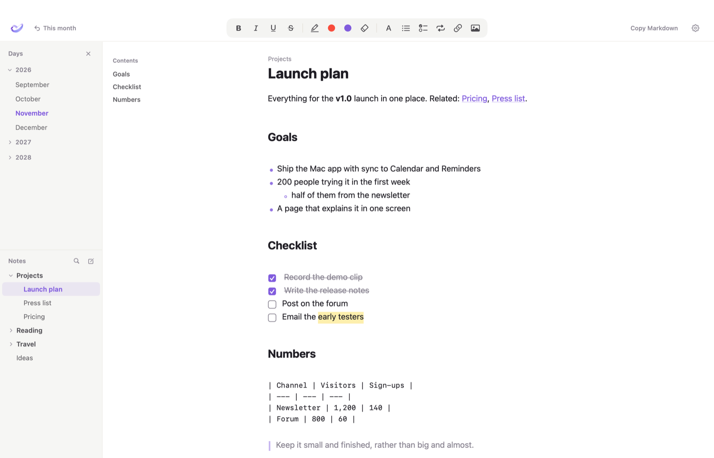
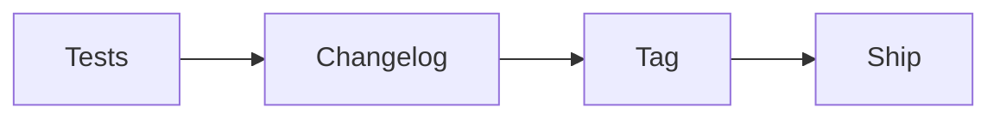

<p align="center">
  
</p>

<h1 align="center">ASMO · 逐日</h1>

<p align="center">
  A planner for macOS written like a document, that your coding agent can use.<br/>
  Write your days in one long page; to-dos go to Apple Calendar and Reminders, and from there to your phone.<br/>
  Free and open source. No account, no server of its own, no model inside the app.
</p>

<p align="center">
  <a href="README.zh.md">中文文档</a> · <a href="https://asmo.entropinia.com/">Website</a> · <a href="https://github.com/realAllenSong/ASMO/releases/latest">Download</a>
</p>

<p align="center">
  <a href="LICENSE"></a>
  
  <a href="https://github.com/realAllenSong/ASMO/releases/latest"></a>
</p>

<p align="center">
  
  <br/><sub>The conversation panel is drawn for this clip; the app frames are real snapshots of ASMO taken as the same commands ran, with made-up items.</sub>
</p>

---

ASMO is one long document of your days, laid out like a journal: each day's date sits in the margin, its things to do beside it. Under each date, a line starting with a bullet is a to-do, a line with a time is on your schedule, and everything else is notes. Write the way you would in any document: when you pause, finished lines are sorted into items, with their times read from what you wrote, however it's written ("2-3点", "二到三点", "2pm-3pm", at the start of the line or the end), and each day's items stand in time order, the timed ones first. Strike a line or click its bullet to check it off.

Your items are kept in Apple Calendar (the ones with a time) and Reminders (the rest), in a calendar and a list named 逐日. That is how they reach your iPhone, watch and anything else signed in to iCloud. It works both ways: check something off, move it, delete it or add one on the phone, and the document follows within seconds.

The `asmo` command is the other way in. Any agent that can run a shell command (Claude Code, Codex) can read your days and change them: add and move items, check things off, and write a day's page in Markdown with pictures, tables and diagrams. Apps without a shell, such as the Claude desktop app, get the same thing through an MCP server. The app itself runs no language model: the agent you already use does the thinking, and ASMO stores exactly what it is told.

<p align="center">
  
  <br/><sub>The document, with made-up items.</sub>
</p>

<p align="center">
  
  <br/><sub>The notes' home page: what to go on with, a few lines from before, every folder at a glance.</sub>
</p>

<p align="center">
  
  <br/><sub>A note: tables, callouts, formulas and diagrams drawn in place, all of it plain Markdown that Obsidian opens too.</sub>
</p>

## What's new in 2.9

- Since 2.9.1, an agent that needs your decision asks in a small window beside the planner; you answer with ✓ or ✗ (`asmo ask`, `asmo answers`, the `ask_user` MCP tool).
- A welcome for new users: what 逐日 is, Calendar and Reminders (asked for with the reason, plus which of your calendars to show), where your notes live (your Obsidian vault as it is, found on the Desktop, in Documents or in iCloud), and birthdays.
- Your own calendars show on their days, read only: holidays, flights, invitations.
- 逐日 no longer opens a notes folder or asks for Calendar before you've said so.

2.8 brought the new icon and colours, tables that wrap, and pictures that open with a click. All changes: [CHANGELOG](CHANGELOG.md) · [Releases](https://github.com/realAllenSong/ASMO/releases)

## Features

- **One document:** days follow each other in one scrolling page, today first, and it runs on as you scroll: every day ahead is there to write on. Days behind today are all there too, written on or not. A sidebar lists the months by year (a year folds away), two years ahead included, and **This month** brings you back.
- **Write, then it's sorted:** finished lines become to-dos and scheduled items on their own and move into time order; headings, quotes and links stay notes. A time without morning or evening reads the way it's said: one to six is the afternoon, and today a morning hour already gone by is the evening ("10" written at 7 pm is 10 pm).
- **Notes:** a folder of Markdown files beside the days, for everything that isn't tied to a day, so an Obsidian vault works as it is. Their home page shows the notes to go on with, a few lines written long ago to read again (new ones every day), and every folder with what's in it. A note is edited as Markdown with a live preview (the marks show on the line you're on): Text and Heading 1–4 from the toolbar, like a word processor, with the open note's headings listed under it in the sidebar to jump to; `[[links]]` with suggestions as you type, `![[pictures]]` (paste or drop one in), checklists, highlights, tables drawn as tables, callouts (`> [!tip]`), coloured code, footnotes, formulas (`$…$` and `$$`, drawn by a copy of KaTeX in the app), mermaid diagrams, and other notes shown inside a note (`![[note]]`).
- **Drawings:** Excalidraw is built in. Open a drawing from the vault or start one from the toolbar, and it's saved the way Obsidian's Excalidraw plugin saves it, so the same file opens there; a note that embeds it shows it as a picture.
- **Days and notes, joined:** type `#` in a line of the days for a short menu: make it repeat (daily, weekdays, weekly, monthly), keep it every year as a birthday or an anniversary, or join it to a note, an existing one or a new one named after the line. A `[[note]]` in a line opens the note in a small window right there, to write in, with a button to open it full size. On the phone the line shows without the link, and the note's name is in its notes.
- **Search everything:** ⌘P finds a note by name, a line in any note, or a to-do on any day, and opens it at that line.
- **Notes sync through Git:** a folder that's a Git repository is committed, pulled and pushed by itself, so Obsidian on the phone sees what you wrote. The days never go there; they go to Apple Calendar and Reminders.
- **Formatting:** on the days, bold, italic, underline, strike, highlight, colours, headings, lists, checkboxes, links and pictures from the toolbar, or Markdown as you type. In a note, the toolbar writes Markdown: paragraph styles, lists, quotes, callouts, tables, formulas, code, drawings.
- **Repeats without syntax:** the repeat button turns the line into a routine: daily, weekdays, weekly on that day, or monthly on that date. Routines can be skipped for one day.
- **Subtasks:** items nest up to three levels; an indented line belongs to the one above.
- **Important dates, in their own time zone:** birthdays, anniversaries and holidays come back every year, in the Gregorian or the Chinese lunar calendar. Each is kept in a time zone and shown when its day begins there: a birthday in China on the 22nd is at 11:00 on the 21st in New York. It is put in Apple Calendar at that moment, with an alert.
- **Apple Calendar and Reminders, both ways:** from today on, items with a time are events and the rest are reminders. Repeating items are there too, a week ahead, one for each day: check one off on the phone and that day is done here. Changes made there come back, including new ones added to the 逐日 list or calendar. A to-do left undone rolls over to today and takes its reminder with it, so the phone shows each thing once. Finished items are kept as completed.
- **The `asmo` command:** everything above from the command line, with JSON answers, including importing years of pages at once (`asmo page import`). Open windows update while the agent works.
- **Markdown pages:** agents write notes as Markdown: headings, emphasis, links, lists, checkboxes, quotes, tables, code blocks, pictures by file path or URL, and mermaid diagrams drawn by a copy of mermaid that ships in the app.
- **Undo:** `asmo undo` takes back the last change an agent made, and the one before it, until the app is restarted.
- **Updates itself:** a new version is one click: ASMO checks GitHub Releases and swaps itself in place.
- **English and Chinese:** the interface follows your Mac, or pick a language in Settings. What you write is never translated.
- **Private:** your data is a local file on your Mac. ASMO has no server or account; what reaches your other devices goes through your own iCloud Calendar and Reminders.

## Install

You need a Mac with Apple silicon and macOS 15 or later.

1. Download `ASMO-v….zip` from [Releases](https://github.com/realAllenSong/ASMO/releases/latest), unzip it and move **ASMO** to Applications. It is signed with a Developer ID and notarized by Apple.
2. Open it. That's all.

When it opens, ASMO connects the assistants on your Mac by itself: it puts the `asmo` command in `~/.local/bin`, gives Claude Code and Codex the skill (when they are installed), and registers its MCP server with the Claude desktop app (when it is installed; restart that app once to load it). **Settings ▸ AI assistants** shows what is connected.

## Updates

ASMO checks GitHub Releases shortly after it opens and once a day. When a newer version is out, it asks. **Update Now** downloads it, checks that it is signed by the same developer, replaces the app and reopens it; **Later** asks again next time. **Settings ▸ Updates** has **Check for Updates**. Your data stays in `~/Library/Application Support/ASMO` and is not touched by an update.

### Build from source

With Xcode 26:

```bash
git clone https://github.com/realAllenSong/ASMO.git
cd ASMO
script/install.sh      # builds, replaces /Applications/ASMO.app, installs asmo, the skill and the MCP entry
```

`script/release.sh` builds the signed, notarized zip (it needs a Developer ID certificate and a notarytool profile). An iPhone app builds from the same source (`script/install-iphone.sh`, with your own Apple developer team), but the agent features are Mac-only for now. Until the phone app syncs directly, use Calendar and Reminders on the phone.

## Use it from an agent

After installing, open a new Claude Code or Codex session anywhere and say what you want:

> I'm running from 9 to 10 tonight, and tomorrow at 3 I have a call with Li about the lease. Put the lease questions on tomorrow's page as a checklist.

The agent finds the `asmo` skill, reads the days involved, and writes the changes. You can also run the command yourself:

```bash
asmo today                                   # tasks with subtasks, routines, dates and the page
asmo add "Call Li about the lease" --day tomorrow --time 15:00 --end 15:30
asmo set 3f9a --time 16:00                   # ids can be shortened to 4+ characters
asmo done 3f9a
asmo list today +7 --open                    # what is still open this week
asmo routine add "Pay rent" --on monthly:1   # daily, weekdays, mon,thu, monthly…
asmo mirror                                  # sync with Calendar and Reminders now
asmo undo
```

Several items at once, with subtasks, as JSON on stdin:

```bash
asmo add --json --day today <<'EOF'
[{"title": "Ship the release", "time": "10:00", "end": "12:00",
  "subtasks": [{"title": "Run the tests"}, {"title": "Write the notes"}]},
 {"title": "Gym", "time": "18:30"}]
EOF
```

A day's page, in Markdown:

````bash
asmo page write today <<'MD'
## Release plan

Shipping **v1.0** today.



| Step | Owner |
| --- | --- |
| Tests | Mei |


MD
asmo page today                # the page as blocks b1, b2, … each with its Markdown
asmo page set today b2 <<< "Shipping **v1.0** on Monday."
asmo attach ~/Desktop/photo.jpg --day today --caption "whiteboard"
````

Notes work the same way:

```bash
asmo notes                                   # every note, by path
asmo note 'Launch plan'                      # its Markdown
asmo note write Ideas --append <<< "- A new idea"
asmo note search pricing
```

`asmo help` lists everything, including routines and important dates.

### MCP

`asmo mcp` is an MCP server on stdin and stdout with the same abilities as tools (`day`, `add_tasks`, `update_task`, `write_page`, `undo` and others). The install script registers it with the Claude desktop app; for any other MCP client, add:

```json
{ "mcpServers": { "asmo": { "command": "/Users/you/.local/bin/asmo", "args": ["mcp"] } } }
```

## How it works

- The app listens on a Unix socket in `~/Library/Application Support/ASMO`. `asmo` sends one JSON request and prints the JSON answer; if the app isn't running, it is started in the background first.
- The app is the only writer of its data, so nothing is changed behind its back and open windows stay current.
- Pages are stored as the same rich text the editor produces, so what an agent writes stays editable by hand. A diagram's source is kept inside its picture, so the page reads back as Markdown.
- If you build the app under your own bundle identifier, tell the command with `ASMO_BUNDLE_ID=com.you.asmo`.

## Privacy

ASMO makes two kinds of network requests of its own: the update check to GitHub Releases, and a preview when you paste a link. Calendar and Reminders sync goes through macOS (EventKit) to whatever account holds the 逐日 calendar and list, normally your iCloud; you can turn it off with `asmo mirror off`. Pictures referenced by URL in a page are downloaded by the `asmo` command on your Mac. Whatever your agent sends to its own provider is between you and that agent; ASMO only receives the commands.

## Development

```bash
swift test                     # the date, parsing and planning rules
script/demo-gif.sh             # records assets/demo.gif from the demo store
script/build_and_run.sh        # Debug build
script/run_test_store.sh       # Debug build on a separate test store
asmo ping --test               # talk to the test store instead of your real data
```

The app is Swift, SwiftUI and SwiftData, with an AppKit text view for the day page. The command in `CLI/` has no dependencies. See [CONTRIBUTING.md](CONTRIBUTING.md).

## License

[GNU AGPL v3](LICENSE), with the attribution terms in [NOTICE](NOTICE). You can use, study, change and share ASMO. If you distribute it or a work based on it, or let people use it over a network, publish your source under the same licence and keep the credit required by [NOTICE](NOTICE).

**Commercial licence:** to use ASMO in a closed-source product or service, or on terms other than the AGPL, [contact us](mailto:song@entropinia.com).

## Acknowledgments

Diagrams are drawn with [mermaid](https://github.com/mermaid-js/mermaid) (MIT), formulas with [KaTeX](https://github.com/KaTeX/KaTeX) (MIT), and drawings with [Excalidraw](https://github.com/excalidraw/excalidraw) (MIT), which run on [React](https://github.com/facebook/react) (MIT) and [lz-string](https://github.com/pieroxy/lz-string) (MIT); all of them ship inside the app.
