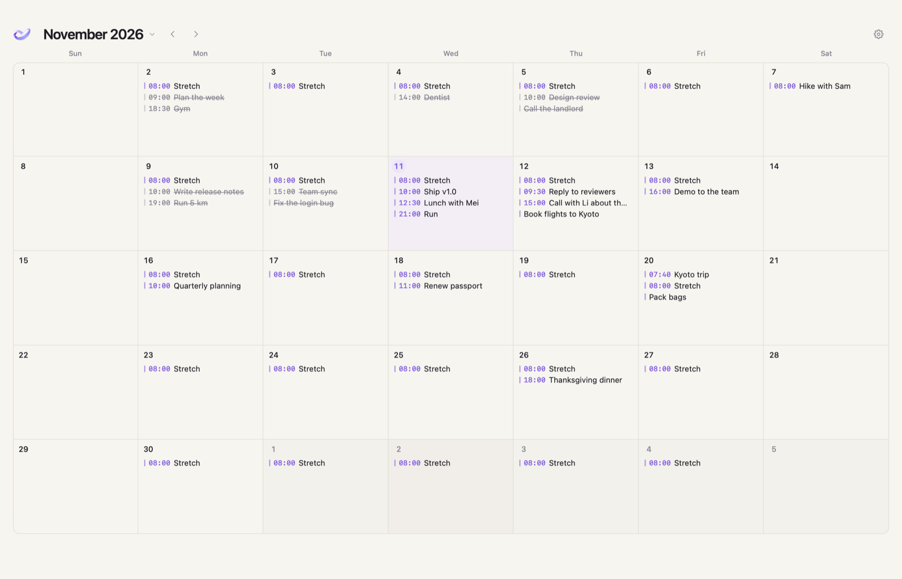
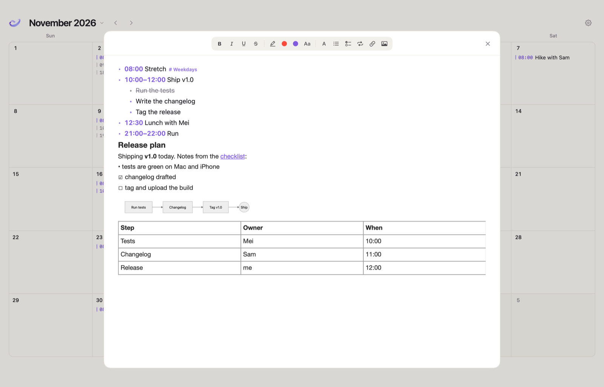
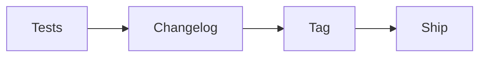

<p align="center">
  
</p>

<h1 align="center">ASMO · 逐日</h1>

<p align="center">
  A calendar and to-do list for macOS that your coding agent can use.<br/>
  Tell Claude Code or Codex what your day looks like, and it shows up in the app as you talk.<br/>
  Free and open source. No account, no cloud, no model inside the app.
</p>

<p align="center">
  <a href="README.zh.md">中文文档</a> · <a href="https://realallensong.github.io/ASMO/">Website</a> · <a href="https://github.com/realAllenSong/ASMO/releases/latest">Download</a>
</p>

<p align="center">
  <a href="LICENSE"></a>
  
  <a href="https://github.com/realAllenSong/ASMO/releases/latest"></a>
</p>

<p align="center">
  
  <br/><sub>The conversation panel is drawn for this clip; the app frames are real snapshots of ASMO taken as the same commands ran, with made-up items.</sub>
</p>

---

ASMO is a quiet month calendar. Each day holds a list of things to do, with times, subtasks and repeating routines, and a free page of notes underneath. You can use it by hand like any calendar.

What makes it different is the `asmo` command. Any agent that can run a shell command (Claude Code, Codex) can read your days and change them: add and move items, check things off, and write a day's page in Markdown with pictures, tables and diagrams. Apps without a shell, such as the Claude desktop app, get the same thing through an MCP server. The app itself runs no language model: the agent you already use does the thinking, and ASMO stores exactly what it is told.

<p align="center">
  
  <br/><sub>The month view, with made-up items.</sub>
</p>

<p align="center">
  
  <br/><sub>One day: the items an agent added, and the page it wrote in Markdown (the flowchart is a mermaid block).</sub>
</p>

## Features

- **Month calendar:** every day shows its items in time order; finished ones are struck through. Click a day for a quick look, double-click to open it.
- **A page per day:** a rich-text editor for the day's items and notes, with bold, italic, highlight, headings, lists, checkboxes, links and pictures.
- **Subtasks and routines:** items nest up to three levels. Routines repeat every day, on weekdays, or on the days you choose, and can be skipped for one day.
- **Important dates:** birthdays, anniversaries and holidays come back every year, in the Gregorian or the Chinese lunar calendar.
- **Apple Calendar and Reminders:** optionally show your Apple Calendar events next to your items (read through the system, with your permission).
- **The `asmo` command:** everything above from the command line, with JSON answers. Open windows update while the agent works.
- **Markdown pages:** agents write notes as Markdown: headings, emphasis, links, lists, checkboxes, quotes, tables, code blocks, pictures by file path or URL, and mermaid diagrams drawn by a copy of mermaid that ships in the app.
- **Undo:** `asmo undo` takes back the last change an agent made, and the one before it, until the app is restarted.
- **English and Chinese:** the interface follows your Mac, or pick a language in Settings. What you write is never translated.
- **Private:** your data is a local file in the app's sandbox. Nothing is uploaded and there is nothing to sign in to.

## Install

You need a Mac with Apple silicon and macOS 15 or later.

1. Download `ASMO-v….zip` from [Releases](https://github.com/realAllenSong/ASMO/releases/latest), unzip it and move **ASMO** to Applications. It is signed with a Developer ID and notarized by Apple.
2. Open it once, then set up the command in Terminal:

   ```bash
   /Applications/ASMO.app/Contents/Helpers/asmo setup
   ```

   This links `asmo` into `~/.local/bin` (add that folder to your `PATH` if it isn't there), gives Claude Code and Codex the skill (`~/.claude/skills/asmo`, `~/.codex/skills/asmo`, when they are installed), and registers the MCP server with the Claude desktop app (when it is installed).

### Build from source

With Xcode 26:

```bash
git clone https://github.com/realAllenSong/ASMO.git
cd ASMO
script/install.sh      # builds, replaces /Applications/ASMO.app, installs asmo and runs asmo setup
```

`script/release.sh` builds the signed, notarized zip (it needs a Developer ID certificate and a notarytool profile). An iPhone app builds from the same source (`script/install-iphone.sh`, with your own Apple developer team), but the agent features are Mac-only for now, and the two do not sync yet.

## Use it from an agent

After installing, open a new Claude Code or Codex session anywhere and say what you want:

> I'm running from 9 to 10 tonight, and tomorrow at 3 I have a call with Li about the lease. Put the lease questions on tomorrow's page as a checklist.

The agent finds the `asmo` skill, reads the days involved, and writes the changes. You can also run the command yourself:

```bash
asmo today                                   # tasks with subtasks, routines, dates and the page
asmo add "Call Li about the lease" --day tomorrow --time 15:00 --end 15:30
asmo set 3f9a --time 16:00                   # ids can be shortened to 4+ characters
asmo done 3f9a
asmo list today +7 --open                    # what is still open this week
asmo undo
```

Several items at once, with subtasks, as JSON on stdin:

```bash
asmo add --json --day today <<'EOF'
[{"title": "Ship the release", "time": "10:00", "end": "12:00",
  "subtasks": [{"title": "Run the tests"}, {"title": "Write the notes"}]},
 {"title": "Gym", "time": "18:30"}]
EOF
```

A day's page, in Markdown:

````bash
asmo page write today <<'MD'
## Release plan

Shipping **v1.0** today.



| Step | Owner |
| --- | --- |
| Tests | Mei |


MD
asmo page today                # the page as blocks b1, b2, … each with its Markdown
asmo page set today b2 <<< "Shipping **v1.0** on Monday."
asmo attach ~/Desktop/photo.jpg --day today --caption "whiteboard"
````

`asmo help` lists everything, including routines and important dates.

### MCP

`asmo mcp` is an MCP server on stdin and stdout with the same abilities as tools (`day`, `add_tasks`, `update_task`, `write_page`, `undo` and others). The install script registers it with the Claude desktop app; for any other MCP client, add:

```json
{ "mcpServers": { "asmo": { "command": "/Users/you/.local/bin/asmo", "args": ["mcp"] } } }
```

## How it works

- The app listens on a Unix socket inside its own sandbox container. `asmo` sends one JSON request and prints the JSON answer; if the app isn't running, it is started in the background first.
- The app is the only writer of its data, so nothing is changed behind its back and open windows stay current.
- Pages are stored as the same rich text the editor produces, so what an agent writes stays editable by hand. A diagram's source is kept inside its picture, so the page reads back as Markdown.
- The first time `asmo` runs from a terminal, macOS may ask whether that terminal can access data from other apps. Allow it: the socket lives in ASMO's container.
- If you build the app under your own bundle identifier, tell the command with `ASMO_BUNDLE_ID=com.you.asmo`.

## Privacy

ASMO makes no network requests of its own, except to load a preview when you paste a link. Pictures referenced by URL in a page are downloaded by the `asmo` command on your Mac. Whatever your agent sends to its own provider is between you and that agent; ASMO only receives the commands.

## Development

```bash
swift test                     # the date, parsing and planning rules
script/demo-gif.sh             # records assets/demo.gif from the demo store
script/build_and_run.sh        # Debug build
script/run_test_store.sh       # Debug build on a separate test store
asmo ping --test               # talk to the test store instead of your real data
```

The app is Swift, SwiftUI and SwiftData, with an AppKit text view for the day page. The command in `CLI/` has no dependencies. See [CONTRIBUTING.md](CONTRIBUTING.md).

## License

[MIT](LICENSE).

## Acknowledgments

Diagrams are drawn with [mermaid](https://github.com/mermaid-js/mermaid) (MIT), which ships inside the app.
