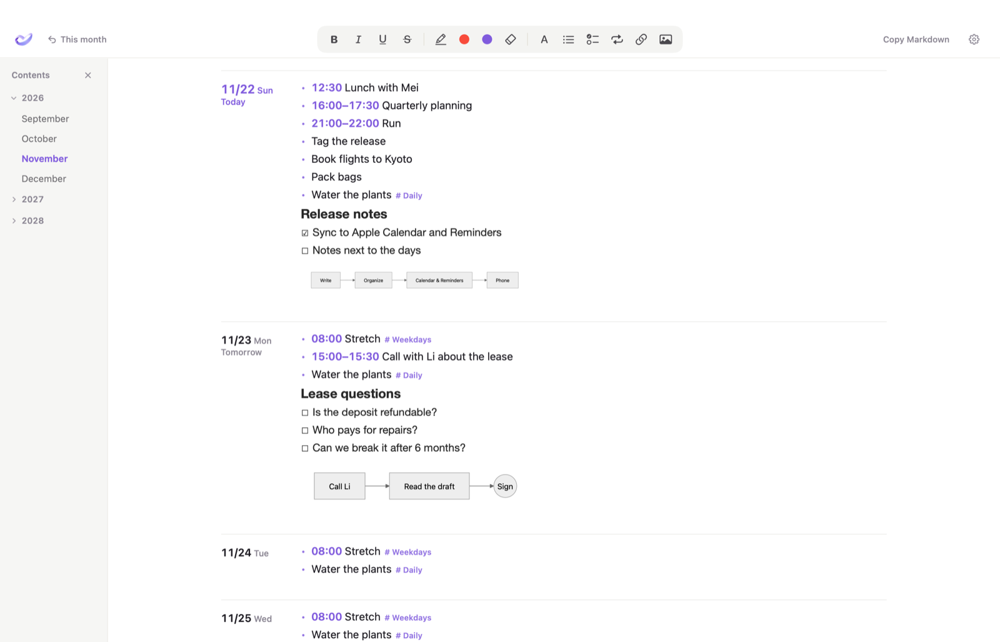
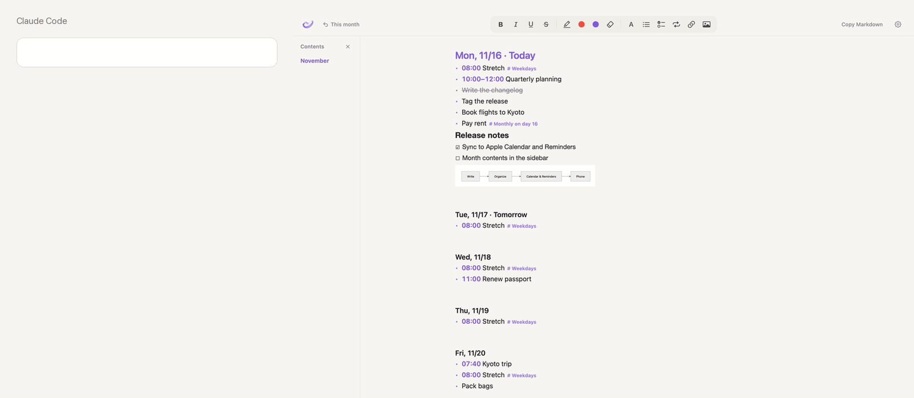
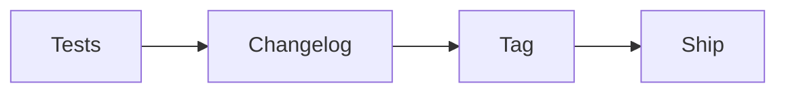

<p align="center">
  
</p>

<h1 align="center">ASMO · 逐日</h1>

<p align="center">
  A planner for macOS written like a document, that your coding agent can use.<br/>
  Write your days in one long page; to-dos go to Apple Calendar and Reminders, and from there to your phone.<br/>
  Free and open source. No account, no server of its own, no model inside the app.
</p>

<p align="center">
  <a href="README.zh.md">中文文档</a> · <a href="https://realallensong.github.io/ASMO/">Website</a> · <a href="https://github.com/realAllenSong/ASMO/releases/latest">Download</a>
</p>

<p align="center">
  <a href="LICENSE"></a>
  
  <a href="https://github.com/realAllenSong/ASMO/releases/latest"></a>
</p>

<p align="center">
  
  <br/><sub>The document, with made-up items.</sub>
</p>

---

ASMO is one long document of your days, like a page in a docs app. Each day has a heading; under it, a line starting with a bullet is a to-do, a line with a time is on your schedule, and everything else is notes. Write the way you would in any document: when you pause, finished lines are sorted into items, with their times read from what you wrote ("9:30 to 10 tonight"). Strike a line or click its bullet to check it off.

Your items are kept in Apple Calendar (the ones with a time) and Reminders (the rest), in a calendar and a list named 逐日. That is how they reach your iPhone, watch and anything else signed in to iCloud. It works both ways: check something off, move it, delete it or add one on the phone, and the document follows within seconds.

The `asmo` command is the other way in. Any agent that can run a shell command (Claude Code, Codex) can read your days and change them: add and move items, check things off, and write a day's page in Markdown with pictures, tables and diagrams. Apps without a shell, such as the Claude desktop app, get the same thing through an MCP server. The app itself runs no language model: the agent you already use does the thinking, and ASMO stores exactly what it is told.

## Features

- **One document:** days follow each other in one scrolling page, today first. A sidebar lists the months to jump to, and **This month** brings you back.
- **Write, then it's sorted:** finished lines become to-dos and scheduled items on their own; headings, quotes and links stay notes. A time without morning or evening is read from the time of day ("10" written at 7 pm is 10 pm).
- **Formatting:** bold, italic, underline, strike, highlight, colours, headings, lists, checkboxes, links and pictures from the toolbar, or Markdown as you type.
- **Repeats without syntax:** the repeat button turns the line into a routine: daily, weekdays, weekly on that day, or monthly on that date. Routines can be skipped for one day.
- **Subtasks:** items nest up to three levels; an indented line belongs to the one above.
- **Important dates:** birthdays, anniversaries and holidays come back every year, in the Gregorian or the Chinese lunar calendar.
- **Apple Calendar and Reminders, both ways:** from today on, items with a time are events and the rest are reminders. Changes made there come back, including new ones added to the 逐日 list or calendar. Finished items are kept as completed; the past stays put.
- **The `asmo` command:** everything above from the command line, with JSON answers, including importing years of pages at once (`asmo page import`). Open windows update while the agent works.
- **Markdown pages:** agents write notes as Markdown: headings, emphasis, links, lists, checkboxes, quotes, tables, code blocks, pictures by file path or URL, and mermaid diagrams drawn by a copy of mermaid that ships in the app.
- **Undo:** `asmo undo` takes back the last change an agent made, and the one before it, until the app is restarted.
- **Updates itself:** a new version is one click: ASMO checks GitHub Releases and swaps itself in place.
- **English and Chinese:** the interface follows your Mac, or pick a language in Settings. What you write is never translated.
- **Private:** your data is a local file on your Mac. ASMO has no server or account; what reaches your other devices goes through your own iCloud Calendar and Reminders.

## Install

You need a Mac with Apple silicon and macOS 15 or later.

1. Download `ASMO-v….zip` from [Releases](https://github.com/realAllenSong/ASMO/releases/latest), unzip it and move **ASMO** to Applications. It is signed with a Developer ID and notarized by Apple.
2. Open it. That's all.

When it opens, ASMO connects the assistants on your Mac by itself: it puts the `asmo` command in `~/.local/bin`, gives Claude Code and Codex the skill (when they are installed), and registers its MCP server with the Claude desktop app (when it is installed; restart that app once to load it). **Settings ▸ AI assistants** shows what is connected.

## Updates

ASMO checks GitHub Releases shortly after it opens and once a day. When a newer version is out, it asks. **Update Now** downloads it, checks that it is signed by the same developer, replaces the app and reopens it; **Later** asks again next time. **Settings ▸ Updates** has **Check for Updates**. Your data stays in `~/Library/Application Support/ASMO` and is not touched by an update.

### Build from source

With Xcode 26:

```bash
git clone https://github.com/realAllenSong/ASMO.git
cd ASMO
script/install.sh      # builds, replaces /Applications/ASMO.app, installs asmo, the skill and the MCP entry
```

`script/release.sh` builds the signed, notarized zip (it needs a Developer ID certificate and a notarytool profile). An iPhone app builds from the same source (`script/install-iphone.sh`, with your own Apple developer team), but the agent features are Mac-only for now. Until the phone app syncs directly, use Calendar and Reminders on the phone.

## Use it from an agent

<p align="center">
  
  <br/><sub>The conversation panel is drawn for this clip; the app frames are real snapshots of ASMO taken as the same commands ran, with made-up items.</sub>
</p>

After installing, open a new Claude Code or Codex session anywhere and say what you want:

> I'm running from 9 to 10 tonight, and tomorrow at 3 I have a call with Li about the lease. Put the lease questions on tomorrow's page as a checklist.

The agent finds the `asmo` skill, reads the days involved, and writes the changes. You can also run the command yourself:

```bash
asmo today                                   # tasks with subtasks, routines, dates and the page
asmo add "Call Li about the lease" --day tomorrow --time 15:00 --end 15:30
asmo set 3f9a --time 16:00                   # ids can be shortened to 4+ characters
asmo done 3f9a
asmo list today +7 --open                    # what is still open this week
asmo routine add "Pay rent" --on monthly:1   # daily, weekdays, mon,thu, monthly…
asmo mirror                                  # sync with Calendar and Reminders now
asmo undo
```

Several items at once, with subtasks, as JSON on stdin:

```bash
asmo add --json --day today <<'EOF'
[{"title": "Ship the release", "time": "10:00", "end": "12:00",
  "subtasks": [{"title": "Run the tests"}, {"title": "Write the notes"}]},
 {"title": "Gym", "time": "18:30"}]
EOF
```

A day's page, in Markdown:

````bash
asmo page write today <<'MD'
## Release plan

Shipping **v1.0** today.



| Step | Owner |
| --- | --- |
| Tests | Mei |


MD
asmo page today                # the page as blocks b1, b2, … each with its Markdown
asmo page set today b2 <<< "Shipping **v1.0** on Monday."
asmo attach ~/Desktop/photo.jpg --day today --caption "whiteboard"
````

`asmo help` lists everything, including routines and important dates.

### MCP

`asmo mcp` is an MCP server on stdin and stdout with the same abilities as tools (`day`, `add_tasks`, `update_task`, `write_page`, `undo` and others). The install script registers it with the Claude desktop app; for any other MCP client, add:

```json
{ "mcpServers": { "asmo": { "command": "/Users/you/.local/bin/asmo", "args": ["mcp"] } } }
```

## How it works

- The app listens on a Unix socket in `~/Library/Application Support/ASMO`. `asmo` sends one JSON request and prints the JSON answer; if the app isn't running, it is started in the background first.
- The app is the only writer of its data, so nothing is changed behind its back and open windows stay current.
- Pages are stored as the same rich text the editor produces, so what an agent writes stays editable by hand. A diagram's source is kept inside its picture, so the page reads back as Markdown.
- If you build the app under your own bundle identifier, tell the command with `ASMO_BUNDLE_ID=com.you.asmo`.

## Privacy

ASMO makes two kinds of network requests of its own: the update check to GitHub Releases, and a preview when you paste a link. Calendar and Reminders sync goes through macOS (EventKit) to whatever account holds the 逐日 calendar and list, normally your iCloud; you can turn it off with `asmo mirror off`. Pictures referenced by URL in a page are downloaded by the `asmo` command on your Mac. Whatever your agent sends to its own provider is between you and that agent; ASMO only receives the commands.

## Development

```bash
swift test                     # the date, parsing and planning rules
script/demo-gif.sh             # records assets/demo.gif from the demo store
script/build_and_run.sh        # Debug build
script/run_test_store.sh       # Debug build on a separate test store
asmo ping --test               # talk to the test store instead of your real data
```

The app is Swift, SwiftUI and SwiftData, with an AppKit text view for the day page. The command in `CLI/` has no dependencies. See [CONTRIBUTING.md](CONTRIBUTING.md).

## License

[MIT](LICENSE).

## Acknowledgments

Diagrams are drawn with [mermaid](https://github.com/mermaid-js/mermaid) (MIT), which ships inside the app.
