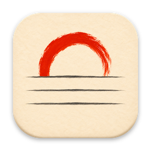
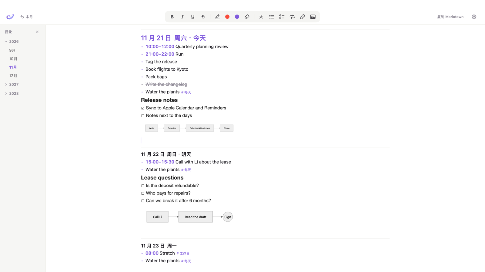
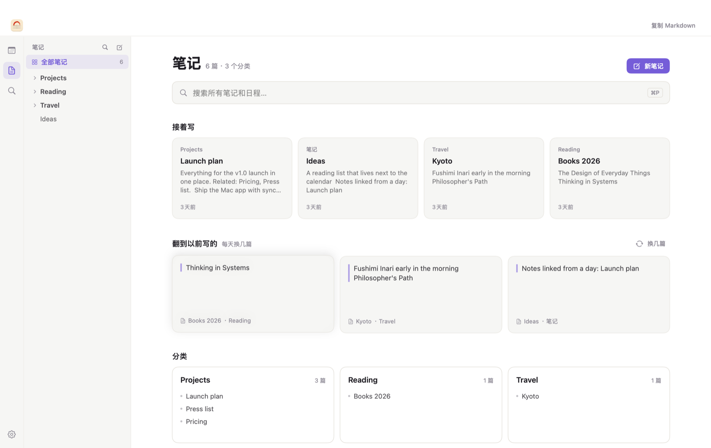
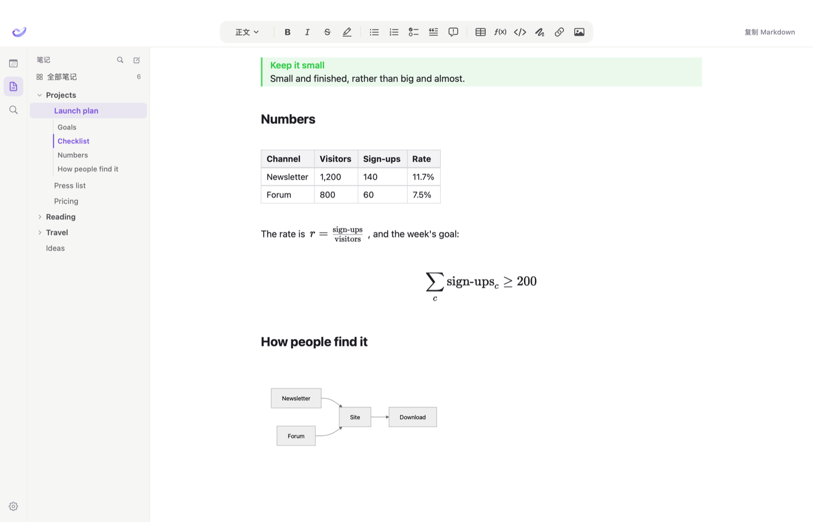
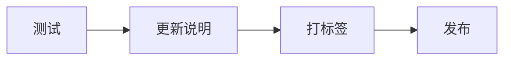

<p align="center">
  
</p>

<h1 align="center">逐日 · ASMO</h1>

<p align="center">
  像写文档一样用的 macOS 计划本，coding agent 也能直接操作。<br/>
  把每一天写在同一页长文档里；待办自动进 Apple 日历和提醒事项，手机上也能看到。<br/>
  免费开源。不用注册，没有自己的服务器，app 里不跑任何模型。
</p>

<p align="center">
  <a href="README.md">English</a> · <a href="https://realallensong.github.io/ASMO/">网站</a> · <a href="https://github.com/realAllenSong/ASMO/releases/latest">下载</a>
</p>

<p align="center">
  <a href="LICENSE"></a>
  
  <a href="https://github.com/realAllenSong/ASMO/releases/latest"></a>
</p>

<p align="center">
  
  <br/><sub>左边的对话面板是为这段动图绘制的；右边的 app 画面是同样的命令执行时逐日的真实快照，内容为虚构。</sub>
</p>

---

逐日是一页长长的文档，排成日记的样子：每天的日期在左边一栏，那天的事就写在旁边。每一天里，以圆点开头的一行是待办，带时间的一行进日程，其余都是笔记。像写普通文档一样写就行：停下来时，写完的行会被整理成事项，时间从你写的字里读出来，怎么写都行（「2-3点」「二到三点」「2pm-3pm」，写在行首或行尾），每天的事项按时间排好，有时间的在前。划掉一行或者点一下前面的圆点，就算完成。

事项会放进 Apple 日历（有时间的）和提醒事项（其余的），在一个叫「逐日」的日历和列表里，再通过 iCloud 到你的 iPhone、手表和其他设备。同步是双向的：在手机上打勾、改时间、删除或新建，几秒内文档就跟着变。

`asmo` 命令是另一条路。任何能运行 shell 命令的 agent（Claude Code、Codex）都可以读取和修改你的每一天：添加和移动事项、打勾，用 Markdown 写当天的页面，包括图片、表格和图表。没有 shell 的应用（比如 Claude 桌面版）通过 MCP 服务获得同样的能力。app 本身不运行任何语言模型：思考由你已经在用的 agent 完成，逐日只按收到的内容原样保存。

<p align="center">
  
  <br/><sub>文档界面，内容是虚构的。</sub>
</p>

<p align="center">
  
  <br/><sub>笔记首页：接着写的、翻到以前写的、所有分类一目了然。</sub>
</p>

<p align="center">
  
  <br/><sub>一篇笔记：表格、提示框、公式和图表就地画出来，底下全是普通的 Markdown，Obsidian 也能打开。</sub>
</p>

## 功能

- **一页文档：** 每天按顺序排在一个可以滚动的页面里，今天在最上面，往下滚会一直接着往后排，未来每一天都可以直接写。今天之前的每一天也都在，不管有没有写东西。侧边栏的目录按年份分组、可以折叠，按月份跳转，包括未来两年，**本月** 一键回到这个月。
- **写完自动整理：** 写完的行自己变成待办和日程，并排到时间顺序里；标题、引用和链接保留为笔记。没说上午还是下午的时间按习惯读：一点到六点是下午；今天已经过去的上午时间算晚上（晚上 7 点写「10 点」就是晚上 10 点）。
- **笔记：** 日程旁边的一个 Markdown 文件夹，放所有不属于某一天的东西，所以 Obsidian 的笔记库直接能用。笔记首页列出接着写的笔记、从以前写的笔记里翻出的几段话（每天换几篇），以及每个分类和里面的笔记。笔记直接编辑 Markdown，带实时预览（光标所在的行才露出符号）：像石墨文档一样，在工具栏里选正文、标题 1–4，打开的笔记的标题就列在侧边栏这篇下面，点一下就跳过去；`[[链接]]` 边打边提示，`![[图片]]`（可以粘贴或拖进来），勾选清单、高亮，表格画成表格，提示框（`> [!tip]`），代码上色，脚注，公式（`$…$` 和 `$$`，由 app 自带的 KaTeX 绘制），mermaid 图表，还能把另一篇笔记嵌进来（`![[笔记]]`）。
- **画板：** 内置 Excalidraw。打开笔记库里的画板，或者从工具栏新建一张，保存的格式和 Obsidian 的 Excalidraw 插件一样，同一个文件在那边也能打开；嵌了画板的笔记会把它显示成图。
- **日程和笔记连起来：** 在日程的一行里打 `#`，会弹出一个小菜单：让这一行重复（每天、工作日、每周、每月），存成每年的生日或纪念日，或者连到一篇笔记，可以是已有的，也可以新建一篇以这一行命名的。行里的 `[[笔记]]` 点一下，就在旁边的小窗口里打开，直接写，也有按钮全屏打开。手机上这一行不显示链接，笔记名写在备注里。
- **全局搜索：** ⌘P 按名字找笔记、找任何一篇笔记里的一行、找任何一天的待办，打开就停在那一行。
- **笔记通过 Git 同步：** 如果笔记文件夹是一个 Git 仓库，会自动提交、拉取和推送，手机上的 Obsidian 也能看到你写的。日程从来不进 Git，它们同步到 Apple 日历和提醒事项。
- **格式：** 在日程里，工具栏有加粗、斜体、下划线、删除线、高亮、颜色、标题、列表、勾选框、链接和图片，也可以边写边用 Markdown。在笔记里，工具栏写的是 Markdown：段落样式、列表、引用、提示框、表格、公式、代码、画板。
- **重复不用记语法：** 点重复按钮，把这一行变成例行事项：每天、工作日、每周这一天，或每月这一号。例行事项可以单独跳过某一天。
- **子任务：** 事项最多嵌套三层；缩进的一行属于上面那一行。
- **重要日子，按对方的时区：** 生日、纪念日和节日每年自动出现，支持公历和农历。每个日子有自己的时区，在那边这一天开始的时刻出现：中国 22 号的生日，在纽约是 21 号上午 11 点。它会在那一刻写进 Apple 日历，并带提醒。
- **Apple 日历和提醒事项，双向同步：** 从今天起，有时间的事项是日历日程，其余是提醒事项。例行事项也在里面，往后一周每天一条：在手机上勾掉，这里那一天就算完成。在那边做的修改会回来，包括在「逐日」列表或日历里新建的。没做完的待办顺延到今天时，提醒也跟着移过来，所以手机上每件事只有一条。完成的事项保留为已完成。
- **`asmo` 命令：** 以上全部都可以从命令行完成，返回 JSON，也能一次导入几年的页面（`asmo page import`）。agent 操作时，打开的窗口会实时更新。
- **Markdown 页面：** agent 用 Markdown 写笔记：标题、强调、链接、列表、勾选框、引用、表格、代码块、图片（本地路径或网址），以及 mermaid 图表，由 app 自带的 mermaid 绘制。
- **撤销：** `asmo undo` 撤回 agent 的上一次修改，可以连续撤回，直到 app 重启为止。
- **自动更新：** 新版本点一下就装好：逐日检查 GitHub Releases，并原地替换自己。
- **中文和英文：** 界面跟随系统，也可以在设置里选语言。你写的内容不会被翻译。
- **隐私：** 数据是你 Mac 上的一个本地文件。逐日没有服务器，也没有账号；到其他设备的内容走的是你自己 iCloud 里的日历和提醒事项。

## 安装

要求：Apple 芯片的 Mac，macOS 15 及以上。

1. 从 [Releases](https://github.com/realAllenSong/ASMO/releases/latest) 下载 `ASMO-v….zip`，解压后把 **逐日** 拖进「应用程序」。它用 Developer ID 签名，并经过 Apple 公证。
2. 打开它。就这样。

打开时，逐日会自己连好这台 Mac 上的助手：把 `asmo` 命令放到 `~/.local/bin`，给 Claude Code 和 Codex 装上 skill（已安装时），并把 MCP 服务注册到 Claude 桌面版（已安装时；重启一次 Claude 桌面版即可加载）。**设置 ▸ AI 助手** 里能看到哪些已经连上。

## 更新

逐日打开后不久、以及之后每天，会检查一次 GitHub Releases。有新版本时会询问你。**立即更新** 会下载新版本，确认它由同一位开发者签名，替换 app 并重新打开；**稍后** 则下次再问。**设置 ▸ 更新** 里也有 **检查更新**。你的数据保存在 `~/Library/Application Support/ASMO`，更新不会动它。

### 从源码构建

需要 Xcode 26：

```bash
git clone https://github.com/realAllenSong/ASMO.git
cd ASMO
script/install.sh      # 构建、替换 /Applications/ASMO.app，并装好 asmo、skill 和 MCP 配置
```

`script/release.sh` 构建签名并公证的 zip（需要 Developer ID 证书和 notarytool 配置）。iPhone 版可以从同一份源码构建（`script/install-iphone.sh`，需要你自己的 Apple 开发者团队），但 agent 功能目前只在 Mac 上。在手机 app 能直接同步之前，手机上请用日历和提醒事项。

## 让 agent 来用

安装之后，在任意目录开一个新的 Claude Code 或 Codex 会话，直接说：

> 今晚九点到十点我要跑步，明天下午三点和小李通电话聊租约。把要问的租约问题写到明天的页面上，做成勾选清单。

agent 会找到 `asmo` 这个 skill，读取相关的日子，再写入修改。你也可以自己运行命令：

```bash
asmo today                                   # 事项（含子任务）、例行事项、重要日子和页面
asmo add "和小李聊租约" --day tomorrow --time 15:00 --end 15:30
asmo set 3f9a --time 16:00                   # id 可以只写前 4 位以上
asmo done 3f9a
asmo list today +7 --open                    # 这一周还没完成的
asmo routine add "交房租" --on monthly:1      # daily、weekdays、mon,thu、monthly…
asmo mirror                                  # 立刻和日历、提醒事项同步一次
asmo undo
```

一次添加多条（可带子任务），从标准输入传 JSON：

```bash
asmo add --json --day today <<'EOF'
[{"title": "发布新版本", "time": "10:00", "end": "12:00",
  "subtasks": [{"title": "跑测试"}, {"title": "写更新说明"}]},
 {"title": "健身", "time": "18:30"}]
EOF
```

用 Markdown 写某一天的页面：

````bash
asmo page write today <<'MD'
## 发布计划

今天发布 **v1.0**。



| 步骤 | 负责人 |
| --- | --- |
| 测试 | 小梅 |


MD
asmo page today                # 页面按块列出：b1、b2……每块带它的 Markdown
asmo page set today b2 <<< "**v1.0** 改到周一发布。"
asmo attach ~/Desktop/photo.jpg --day today --caption "白板"
````

笔记也一样：

```bash
asmo notes                                   # 全部笔记和路径
asmo note 'Launch plan'                      # 它的 Markdown
asmo note write Ideas --append <<< "- 一个新想法"
asmo note search 定价
```

`asmo help` 列出全部命令，包括例行事项和重要日子。

### MCP

`asmo mcp` 是一个走标准输入输出的 MCP 服务，以工具的形式提供同样的能力（`day`、`add_tasks`、`update_task`、`write_page`、`undo` 等）。安装脚本会把它注册到 Claude 桌面版；其他 MCP 客户端可以加上：

```json
{ "mcpServers": { "asmo": { "command": "/Users/you/.local/bin/asmo", "args": ["mcp"] } } }
```

## 工作原理

- app 在 `~/Library/Application Support/ASMO` 里监听一个 Unix socket。`asmo` 发送一条 JSON 请求并打印 JSON 回答；app 没在运行时，会先在后台启动它。
- 只有 app 写自己的数据，所以不会有东西在它背后被改动，打开的窗口始终是最新的。
- 页面保存的是编辑器本身产生的那种富文本，所以 agent 写的内容仍然可以手动编辑。图表的源码保存在图片内部，所以页面可以原样读回 Markdown。
- 如果你用自己的 bundle identifier 构建，用 `ASMO_BUNDLE_ID=com.you.asmo` 告诉命令。

## 隐私

逐日自己只发起两种网络请求：向 GitHub Releases 检查更新，以及你粘贴链接时加载预览。日历和提醒事项的同步由 macOS（EventKit）完成，去往存放「逐日」日历和列表的账户，通常是你的 iCloud；可以用 `asmo mirror off` 关掉。页面里用网址引用的图片，由 `asmo` 命令在你的 Mac 上下载。你的 agent 把什么内容发给它的服务商，是你和那个 agent 之间的事；逐日只接收命令。

## 开发

```bash
swift test                     # 日期、解析和排程规则
script/demo-gif.sh             # 用演示库录制 assets/demo.gif
script/build_and_run.sh        # Debug 构建
script/run_test_store.sh       # 在独立的测试库上运行 Debug 构建
asmo ping --test               # 连接测试库，而不是真实数据
```

app 用 Swift、SwiftUI 和 SwiftData 写成，每天的页面是一个 AppKit 文本视图。`CLI/` 里的命令没有任何依赖。参见 [CONTRIBUTING.md](CONTRIBUTING.md)。

## 许可

[GNU AGPL v3](LICENSE)，署名要求见 [NOTICE](NOTICE)。你可以自由使用、研究、修改和分享逐日。如果分发它或基于它的作品，或通过网络把它提供给别人使用，需要以同样的许可证公开源代码，并保留“Based on ASMO by Zhiyuan Song”的署名。

**商业授权：**如果想在闭源产品或服务中使用逐日，或需要 AGPL 以外的条款，请[联系我们](mailto:song@entropinia.com)。

## 致谢

图表由 [mermaid](https://github.com/mermaid-js/mermaid)（MIT）绘制，公式由 [KaTeX](https://github.com/KaTeX/KaTeX)（MIT）绘制，画板用的是 [Excalidraw](https://github.com/excalidraw/excalidraw)（MIT），它依赖 [React](https://github.com/facebook/react)（MIT）和 [lz-string](https://github.com/pieroxy/lz-string)（MIT）；这些都随 app 一起分发。
