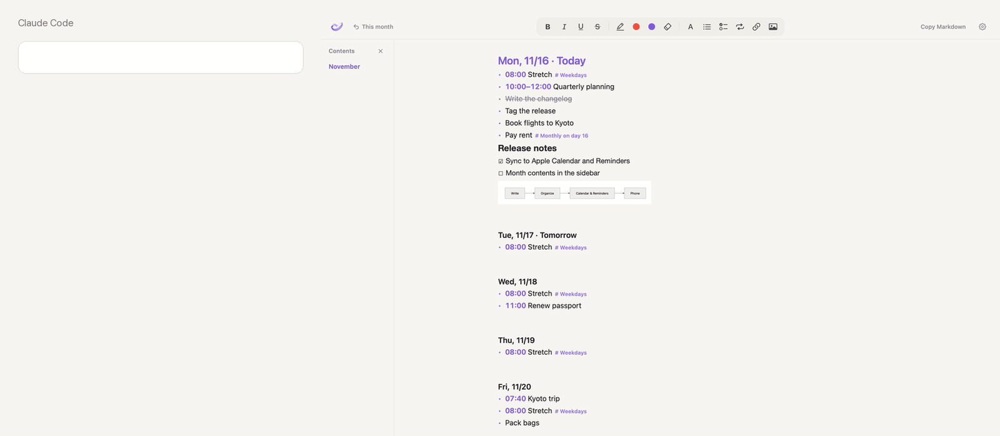
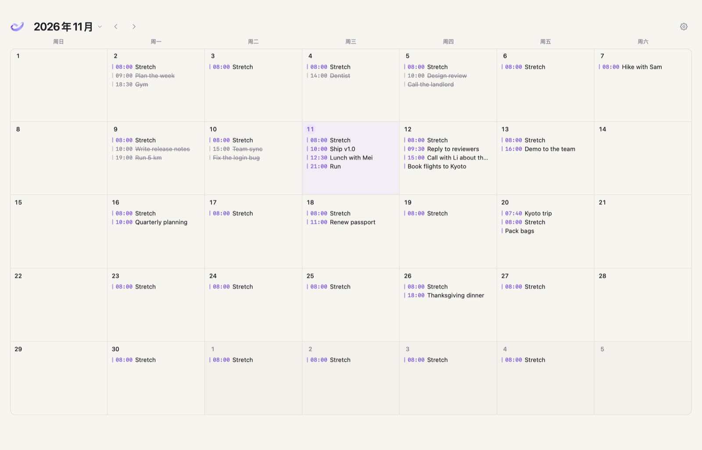
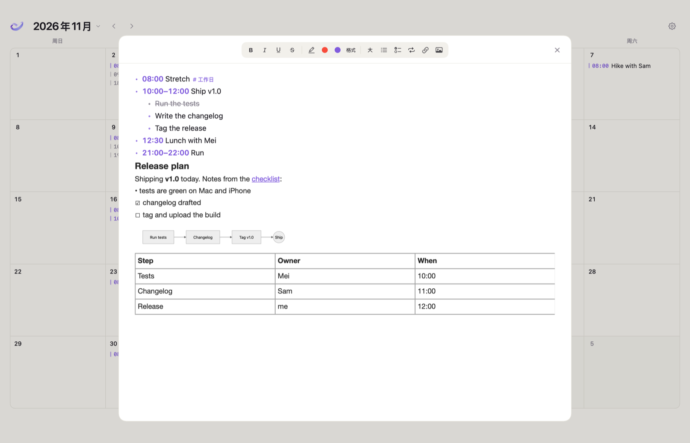

<p align="center">
  
</p>

<h1 align="center">逐日 · ASMO</h1>

<p align="center">
  一个 coding agent 能直接操作的 macOS 日历和待办。<br/>
  把今天的安排告诉 Claude Code 或 Codex，它一边听，内容一边出现在 app 里。<br/>
  免费开源。不用注册，不上云，app 里不跑任何模型。
</p>

<p align="center">
  <a href="README.md">English</a> · <a href="https://realallensong.github.io/ASMO/">网站</a> · <a href="https://github.com/realAllenSong/ASMO/releases/latest">下载</a>
</p>

<p align="center">
  <a href="LICENSE"></a>
  
  <a href="https://github.com/realAllenSong/ASMO/releases/latest"></a>
</p>

<p align="center">
  
  <br/><sub>左边的对话面板是为这段动图绘制的；右边的 app 画面是同样的命令执行时逐日的真实快照，内容为虚构。</sub>
</p>

---

逐日是一个安静的月历。每一天有一份待办，可以带时间、子任务和重复的例行事项，下面还有一页自由的笔记。你可以像用普通日历一样手动使用它。

它的不同之处是 `asmo` 这个命令。任何能运行 shell 命令的 agent（Claude Code、Codex）都可以读取和修改你的每一天：添加和移动事项、打勾，用 Markdown 写当天的页面，包括图片、表格和图表。没有 shell 的应用（比如 Claude 桌面版）通过 MCP 服务获得同样的能力。app 本身不运行任何语言模型：思考由你已经在用的 agent 完成，逐日只按收到的内容原样保存。

<p align="center">
  
  <br/><sub>月视图，内容是虚构的。</sub>
</p>

<p align="center">
  
  <br/><sub>某一天：agent 添加的事项，以及它用 Markdown 写的页面（流程图是一个 mermaid 代码块）。</sub>
</p>

## 功能

- **月历：** 每天按时间顺序显示事项，完成的划掉。单击某天快速查看，双击打开。
- **每天一页：** 一个富文本编辑器，用来写当天的事项和笔记，支持加粗、斜体、高亮、标题、列表、勾选框、链接和图片。
- **子任务和例行事项：** 事项最多嵌套三层。例行事项可以每天、工作日或指定星期重复，也可以单独跳过某一天。
- **重要日子：** 生日、纪念日和节日每年自动出现，支持公历和农历。
- **Apple 日历和提醒事项：** 可以选择把 Apple 日历里的日程显示在事项旁边（经你授权，通过系统读取）。
- **`asmo` 命令：** 以上全部都可以从命令行完成，返回 JSON。agent 操作时，打开的窗口会实时更新。
- **Markdown 页面：** agent 用 Markdown 写笔记：标题、强调、链接、列表、勾选框、引用、表格、代码块、图片（本地路径或网址），以及 mermaid 图表，由 app 自带的 mermaid 绘制。
- **撤销：** `asmo undo` 撤回 agent 的上一次修改，可以连续撤回，直到 app 重启为止。
- **中文和英文：** 界面跟随系统，也可以在设置里选语言。你写的内容不会被翻译。
- **隐私：** 数据是 app 沙盒里的一个本地文件。不上传任何内容，也没有账号。

## 安装

要求：Apple 芯片的 Mac，macOS 15 及以上。

1. 从 [Releases](https://github.com/realAllenSong/ASMO/releases/latest) 下载 `ASMO-v….zip`，解压后把 **逐日** 拖进「应用程序」。它用 Developer ID 签名，并经过 Apple 公证。
2. 打开一次，然后在终端里装好命令：

   ```bash
   /Applications/ASMO.app/Contents/Helpers/asmo setup
   ```

   它会把 `asmo` 链接到 `~/.local/bin`（如果这个目录不在 `PATH` 里，请加上），给 Claude Code 和 Codex 装上 skill（已安装时放到 `~/.claude/skills/asmo` 和 `~/.codex/skills/asmo`），并把 MCP 服务注册到 Claude 桌面版（已安装时）。

### 从源码构建

需要 Xcode 26：

```bash
git clone https://github.com/realAllenSong/ASMO.git
cd ASMO
script/install.sh      # 构建、替换 /Applications/ASMO.app、安装 asmo 并运行 asmo setup
```

`script/release.sh` 构建签名并公证的 zip（需要 Developer ID 证书和 notarytool 配置）。iPhone 版可以从同一份源码构建（`script/install-iphone.sh`，需要你自己的 Apple 开发者团队），但 agent 功能目前只在 Mac 上，两端也还不同步。

## 让 agent 来用

安装之后，在任意目录开一个新的 Claude Code 或 Codex 会话，直接说：

> 今晚九点到十点我要跑步，明天下午三点和小李通电话聊租约。把要问的租约问题写到明天的页面上，做成勾选清单。

agent 会找到 `asmo` 这个 skill，读取相关的日子，再写入修改。你也可以自己运行命令：

```bash
asmo today                                   # 事项（含子任务）、例行事项、重要日子和页面
asmo add "和小李聊租约" --day tomorrow --time 15:00 --end 15:30
asmo set 3f9a --time 16:00                   # id 可以只写前 4 位以上
asmo done 3f9a
asmo list today +7 --open                    # 这一周还没完成的
asmo undo
```

一次添加多条（可带子任务），从标准输入传 JSON：

```bash
asmo add --json --day today <<'EOF'
[{"title": "发布新版本", "time": "10:00", "end": "12:00",
  "subtasks": [{"title": "跑测试"}, {"title": "写更新说明"}]},
 {"title": "健身", "time": "18:30"}]
EOF
```

用 Markdown 写某一天的页面：

````bash
asmo page write today <<'MD'
## 发布计划

今天发布 **v1.0**。


| 步骤 | 负责人 |
| --- | --- |
| 测试 | 小梅 |


MD
asmo page today                # 页面按块列出：b1、b2……每块带它的 Markdown
asmo page set today b2 <<< "**v1.0** 改到周一发布。"
asmo attach ~/Desktop/photo.jpg --day today --caption "白板"
````

`asmo help` 列出全部命令，包括例行事项和重要日子。

### MCP

`asmo mcp` 是一个走标准输入输出的 MCP 服务，以工具的形式提供同样的能力（`day`、`add_tasks`、`update_task`、`write_page`、`undo` 等）。安装脚本会把它注册到 Claude 桌面版；其他 MCP 客户端可以加上：

```json
{ "mcpServers": { "asmo": { "command": "/Users/you/.local/bin/asmo", "args": ["mcp"] } } }
```

## 工作原理

- app 在自己的沙盒容器里监听一个 Unix socket。`asmo` 发送一条 JSON 请求并打印 JSON 回答；app 没在运行时，会先在后台启动它。
- 只有 app 写自己的数据，所以不会有东西在它背后被改动，打开的窗口始终是最新的。
- 页面保存的是编辑器本身产生的那种富文本，所以 agent 写的内容仍然可以手动编辑。图表的源码保存在图片内部，所以页面可以原样读回 Markdown。
- 第一次从终端运行 `asmo` 时，macOS 可能会询问是否允许这个终端访问其他 app 的数据。请允许：socket 在逐日的容器里。
- 如果你用自己的 bundle identifier 构建，用 `ASMO_BUNDLE_ID=com.you.asmo` 告诉命令。

## 隐私

逐日自己不发起网络请求，只有在你粘贴链接时加载预览。页面里用网址引用的图片，由 `asmo` 命令在你的 Mac 上下载。你的 agent 把什么内容发给它的服务商，是你和那个 agent 之间的事；逐日只接收命令。

## 开发

```bash
swift test                     # 日期、解析和排程规则
script/demo-gif.sh             # 用演示库录制 assets/demo.gif
script/build_and_run.sh        # Debug 构建
script/run_test_store.sh       # 在独立的测试库上运行 Debug 构建
asmo ping --test               # 连接测试库，而不是真实数据
```

app 用 Swift、SwiftUI 和 SwiftData 写成，每天的页面是一个 AppKit 文本视图。`CLI/` 里的命令没有任何依赖。参见 [CONTRIBUTING.md](CONTRIBUTING.md)。

## 许可

[MIT](LICENSE)。

## 致谢

图表由 [mermaid](https://github.com/mermaid-js/mermaid)（MIT）绘制，它随 app 一起分发。
