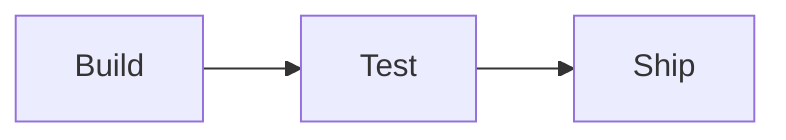

# asmo

`asmo` talks to the 逐日 (ASMO) app on this Mac. The app starts in the background if it isn't running, and open
windows update as you work. Answers are JSON. Run `asmo help` for the full list.
If `asmo` isn't on the PATH, use `/Applications/ASMO.app/Contents/Helpers/asmo`.

You do the thinking; the app stores exactly what you send. Work out dates and times yourself and pass them
explicitly — nothing is guessed from the title.

## Read first

```bash
asmo today                 # tasks (subtasks nested), routines, and the text of the day's page
asmo day 2026-11-14
asmo list today +7 --open  # unfinished tasks in a range
asmo search "report"
```

Look before you write: check the day for an item that already says the same thing, and change it instead of
adding a second one.

## Write

```bash
asmo add "Call Li about the lease" --day tomorrow --time 15:00 --end 15:30 --note "ask about the deposit"
asmo set 3f9a --time 16:00          # ids can be shortened to 4+ characters; a new start keeps the length
asmo set 3f9a --day +2 --time none  # move it, drop the time
asmo done 3f9a 81c2
asmo rm 3f9a                        # subtasks go with it
```

Several items, or anything with subtasks, in one call:

```bash
asmo add --json --day today <<'EOF'
[
  {"title": "Ship the release", "time": "10:00", "end": "12:00",
   "subtasks": [{"title": "Run the tests"}, {"title": "Write the notes"}]},
  {"title": "Gym", "time": "18:30"},
  {"title": "Renew the domain", "day": "2026-12"}
]
EOF
```

- Days: `YYYY-MM-DD`, `today`, `tomorrow`, `yesterday`, `+N` / `-N`, or `YYYY-MM` for "some time that month".
- Times: 24-hour `HH:MM`. An end earlier than the start means the next day.
- Titles are short and say the thing to do; keep the user's language. Detail goes in `--note`.
- Subtasks: up to three levels; they move with their parent.

## The day's page (notes, pictures, diagrams)

Every day has a free page under its items. Write it in Markdown; it shows up in the app as formatted text the user
can keep editing. Things to do belong in `asmo add`, not on the page.

````bash
asmo page today                       # the page as blocks b1, b2, … each with its Markdown
asmo page write today <<'MD'          # goes at the end; --replace rewrites the page; --after b2 | top places it
## Launch notes

Decided to ship **Friday**. Details in the [doc](https://example.com/doc).

| Step | Owner |
| --- | --- |
| Tests | Li |




MD
asmo page set today b3 <<< "Decided to ship **Monday**."   # replace one block
asmo page rm today b5 b6
asmo attach ~/Desktop/photo.jpg --day today --caption "whiteboard"
````

- Supported: headings, bold, italic, strike, `code`, links, bullet and numbered lists, `- [ ]` checkboxes, quotes,
  tables, fenced code, mermaid diagrams in a `mermaid` code fence (drawn as pictures; a mistake in the diagram
  comes back as an error to fix), and pictures by file path or URL.
- Block ids are positions: read the page right before `set` / `rm`.
- A picture already on the page reads back as ``; keep that text to keep the picture.

Many days at once (a journal or an old planner being brought in): list what exists, then import in one go.

```bash
asmo pages 2021-01-01 2026-10-31        # which days have a page: day, length, first line
asmo page import --file pages.json      # {"YYYY-MM-DD": "Markdown", …}; only days with no page yet
asmo page import --replace --file pages.json   # rewrite those days (--append adds below instead)
```

- One save and one `asmo undo` for the whole import; check `asmo pages` before replacing anything.
- Plain text from elsewhere: escape Markdown characters (`\*`, `\_`, `\|`, `\#`, a leading `-` or `1.`) so it reads
  literally, and separate lines with a blank line.

## Important dates

```bash
asmo dates
asmo date add "Mum's birthday" --on 03-08 --lunar               # --kind birthday | anniversary | holiday
asmo date add "Li's birthday" --on 06-17 --zone America/New_York
asmo date set 4778 --zone Asia/Shanghai                         # also --title, --on, --kind, --lunar
asmo date rm 4778
```

- A date comes back every year. `--year YYYY` makes it a one-time date in that year only; it is not a birth year.
- `--zone` is where the day is counted (a time zone name, or `device` for wherever this Mac is). Birthdays are in
  China time unless set otherwise. A date kept in another zone shows on the local day and time it begins there:
  a birthday on the 22nd in China is at 11:00 on the 21st in New York. `asmo day` gives that as `"begins"` and
  `"dayThere"`. Each one is also put in Apple Calendar at that moment, with an alert.
- A lunar date imported together with a Gregorian one (`"also": "11-19"`) shows on both.

## Notes (the user's notes: Markdown files, an Obsidian vault)

Besides the days, 逐日 keeps the user's notes (accounts, spending, study notes, ideas) as Markdown files in a
folder. They use Obsidian syntax, and 逐日 draws all of it in place: `[[Note]]` links, `![[picture.png]]` pictures,
`![[Other note]]` / `![[Other note#Heading]]` embeds, `- [ ]` tasks, `## headings` (listed in the sidebar), tables,
callouts (`> [!tip] Title` then `> lines`), fenced code (coloured), `$x^2$` and `$$` blocks (KaTeX), ```` ```mermaid ````
diagrams, `[^1]` footnotes, `%%comments%%`. Drawings are Obsidian Excalidraw files (`name.excalidraw.md`, embedded as
`![[name.excalidraw]]`); don't write their JSON by hand, the user draws them in the app.

```bash
asmo notes                         # every note, by path inside the folder
asmo notes 个人                    # the notes in one folder
asmo note 账号                     # a note's Markdown, by name or by path ("个人/账号")
asmo note write 个人/想法 --new <<'MD'
## 一个想法
- [ ] 先做这个
MD
asmo note write 想法 --append <<< "- 再加一条"     # add at the end
asmo note search 选课               # names containing it, and lines that do
asmo note mv 想法 归档/旧想法         # rename / move; [[links]] to it follow
asmo note rm 归档/旧想法              # to the Trash
```

- Write the note as the whole Markdown file (`--append` to add, never rewrite a note to add one line).
- A schedule item belongs on a day (`asmo add`); a note is for what isn't tied to a day.
- The folder syncs with GitHub by itself (the phone reads it with Obsidian); nothing to do for that.

## Routines (repeating items)

```bash
asmo routines
asmo routine add "Stretch" --on weekdays --time 08:00     # daily | weekdays | weekends | mon,thu
asmo routine done 27f4 --day today                        # done | skip | clear, for one day
asmo routine stop 27f4                                    # ends it from today on
```

## Rules

- `asmo undo` takes back the last change made with asmo (repeat for earlier ones), until the app is restarted.
  Still, delete only what the user asked to remove.
- Items with `"appleCalendar": true` mirror Apple Calendar and can't be changed here.
- Stay in the background: use `asmo open` only when the user asks to see the app.
- After changing things, tell the user briefly what is now on which day (titles and times, not ids).
